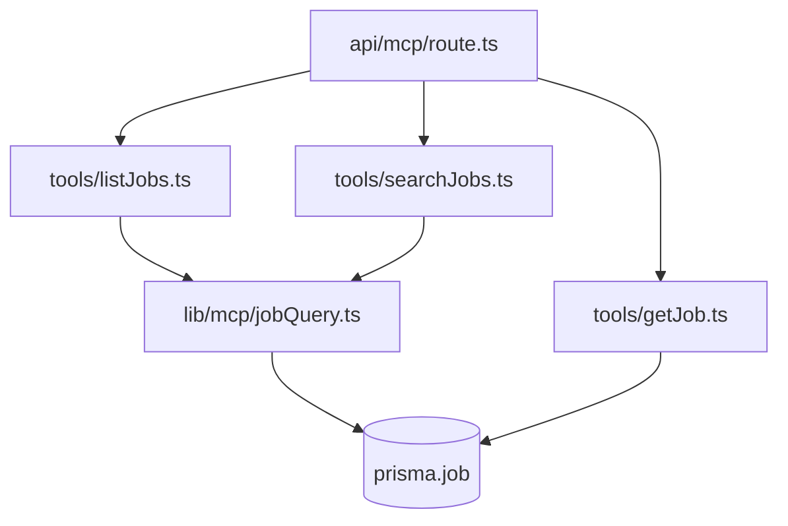

# Design Document

## Overview

Three read-only MCP tools are added to the existing server: `get_job` returns one job in full, `list_jobs` returns a filtered, sorted, cursor-paged list, and `search_jobs` is `list_jobs` plus a free-text query. They sit beside the nine existing tools in `src/app/api/mcp/route.ts` and reuse the established handler contract, the shared rate limiter and the app's own Prisma query patterns from `src/actions/job/queries.ts`.

## Steering Document Alignment

### Technical Standards (tech.md)
N/A — this project has no steering documents; the binding standards are the upstream conventions listed in section 4 of the spec outline and the shapes already in `src/lib/mcp/`.

### Project Structure (structure.md)
N/A — file placement follows the existing MCP layout: one handler per tool under `src/lib/mcp/tools/`, shared helpers beside `src/lib/mcp/rate-limit.ts`, Zod shapes in `src/models/mcp.schema.ts`.

### Design System (design-system.md) — if applicable
N/A — no UI surface. Token scope badges in `src/components/settings/McpAccessSettings.tsx` render from token data and need no edit.

## Architecture

The three tools share one query module and two formatters. `src/lib/mcp/jobQuery.ts` owns everything both list tools need: the Zod-parsed filter set to a Prisma `where` clause, the keyset cursor encode/decode, and the one-line row renderer. `listJobs.ts` and `searchJobs.ts` are thin handlers over it; `searchJobs.ts` passes a `query` through to the same builder, which adds one OR block inside the shared `AND` array. `getJob.ts` shares nothing with them but the rate-limit call and the response shape, so it can ship first with no dependency on the other two.



## Components and Interfaces

### `src/lib/mcp/jobQuery.ts` (new, PR 2)
- **Purpose:** Turn a validated filter set into a Prisma `where`, apply keyset paging, render rows.
- **Interfaces:**
  - `buildJobWhere(userId: string, f: JobReadFilters): Prisma.JobWhereInput`
  - `encodeCursor(c: CursorPayload): string` / `decodeCursor(s: string): CursorPayload | null`
  - `fingerprint(f: JobReadFilters): string`
  - `formatJobRow(job: JobRow): string`
  - `runJobQuery(userId, input): Promise<{ rows, total, nextCursor }>`
- **Dependencies:** `@/lib/db`, `@/lib/constants`, `crypto` (already used by `src/lib/mcp/tokens.ts:1`).
- **Reuses:** the filter-building idiom of `src/actions/job/queries.ts:89-174`, and `hideUnanalyzedScore` from `src/actions/job/shared.ts:9-17`.

### `src/lib/mcp/tools/getJob.ts` (new, PR 1)
- **Purpose:** One job, in full, as labelled sections.
- **Interfaces:** `handleGetJob(input: { jobId: string }, userId: string)`
- **Dependencies:** `@/lib/db`, `@/lib/mcp/rate-limit`.
- **Reuses:** the include graph `JOB_DETAILS_INCLUDE` at `src/actions/job/queries.ts:45-77` — which already carries `stages` through `STAGE_DETAIL_INCLUDE` (`src/actions/jobStage/shared.ts:9-32`) — extended with the job's notes relation; the error-as-text shape of `src/lib/mcp/tools/findJob.ts:66-70`.

### `src/lib/mcp/tools/listJobs.ts` (new, PR 2) and `searchJobs.ts` (new, PR 3)
- **Purpose:** Paged list, and the same list narrowed by free text.
- **Interfaces:** `handleListJobs(input, userId)` / `handleSearchJobs(input, userId)`
- **Dependencies:** `@/lib/mcp/jobQuery`, `@/lib/mcp/rate-limit`.
- **Reuses:** the shared query module above for both, and the handler contract of `src/lib/mcp/tools/findJob.ts:5-9`.

### `src/models/mcp.schema.ts` (edited, PRs 1-3)
- **Purpose:** Input shapes and parsed schemas: `McpGetJobInputShape` (PR 1), `McpListJobsInputShape` (PR 2), `McpSearchJobsInputShape` (PR 3, the list shape plus a required `query`).
- **Reuses:** the `status` enum preprocessing at `src/models/mcp.schema.ts:38-49`, which lowercases before the enum check.

### `src/actions/mcpToken.actions.ts` (edited, PR 1)
- **Purpose:** Requirement 6 criterion 1. The hardcoded scope list at `src/actions/mcpToken.actions.ts:46` gains `jobs:read`. One line; no migration and no backfill of existing rows, because D5 accepts the write scope as an alias.

### `src/lib/mcp/toolDescriptions.ts` (edited, PRs 1-3)
- **Purpose:** One entry per new tool. PR 3 additionally rewrites the existing find_job entry to contrast it with the new search tool, satisfying Requirement 3 criterion 4. That edit ships in PR 3, never earlier, so no description names a tool the server has not registered.

### `wiki/mcp.md` (edited, PRs 1-3)
- **Purpose:** Requirement 6 criterion 4 and the outline's docs constraint. Each PR adds its own tool bullet to the tool list and its own wiki section. PR 1 also rewrites the scopes sentence at `wiki/mcp.md:84`.

### `evals/mcp-tools/` (edited, PRs 2-3)
- **Purpose:** The outline's eval constraint. Each new tool joins the shape registry in `evals/mcp-tools/tools.ts`. Routing cases land in PR 2 ("what's open?" routes to the list tool) and PR 3 (a repost routes to the search tool, while an exact-URL dedupe still routes to find_job).

### `src/app/api/mcp/route.ts` (edited, PRs 1-3)
- **Purpose:** Register the tools and gate them on scope.
- **Reuses:** the inline scope-check block at `src/app/api/mcp/route.ts:92-99`, naming the read scope and accepting the write scope as an alias (D5).

## Data Models

### Cursor payload (opaque to the caller)
```
base64url(JSON.stringify({
  v: string | null,   // sort field's value on the page's last row, ISO-8601; null inside the null run
  id: string,         // that row's id — the tiebreaker
  s: "created" | "applied" | "due",
  o: "asc" | "desc",
  f: string           // fingerprint, below
}))
```

### Fingerprint (`f`)
First 8 hex of sha256 over `JSON.stringify` of the filter entries sorted by key, built from exactly these fields and no others: `status, company, location, applied, tag, origin, createdVia, discoveryStatus, matchScoreMin, matchScoreMax, createdFrom, createdTo, appliedFrom, appliedTo, dueFrom, dueTo, query, sortBy, sortOrder`. Omitted fields are dropped, not defaulted; strings are trimmed and lowercased; dates are normalized to epoch milliseconds. `limit` and `cursor` are excluded, so changing page size mid-walk is allowed. `query` is included, so a `search_jobs` cursor cannot be replayed against a different query.

### Filter set (`McpListJobsInputShape`)
```
status?: enum(JOB_STATUS_VALUES)      tag?: string              limit?: 1-100 (default 25)
company?: string                      createdVia?: string       cursor?: string
location?: string                     origin?: enum             sortBy?: "created"|"applied"|"due"
applied?: boolean                     matchScoreMin?: 0-100     sortOrder?: "asc"|"desc"
discoveryStatus?: enum                matchScoreMax?: 0-100
createdFrom/To?, appliedFrom/To?, dueFrom/To?: ISO-8601 datetime
query?: string                        // search_jobs only, required there
```

### Keyset predicates
`orderBy` is always `[{ <field>: dir }, { id: dir }]`. SQLite sorts NULL low, so descending puts nulls last and ascending puts them first (D4). The page-2 predicate branches on the cursor's `v`, and is placed inside the shared `AND` array so it never clobbers another `OR`:

```
desc, v !== null:  OR: [ { F: { lt: v } }, { F: v, id: { lt: c } }, { F: null } ]
desc, v === null:  AND: [ { F: null }, { id: { lt: c } } ]
asc,  v !== null:  OR: [ { F: { gt: v } }, { F: v, id: { gt: c } } ]
asc,  v === null:  OR: [ { F: null, id: { gt: c } }, { F: { not: null } } ]
```
`createdAt` is non-null, so only the `v !== null` branches ever run for the default sort — and for that column the `{ F: null }` arm is omitted altogether, because Prisma refuses a `null` filter on a non-nullable field.

### List row (one line)
```
<id> | <title> @ <company> | <status> | applied <YYYY-MM-DD|-> | due <YYYY-MM-DD|-> | <location|-> | via <source|-> | match <n%|-> | <origin label>
```
Every interpolated free-text value is sanitized first: whitespace runs (including newlines and tabs) collapse to one space, `|` becomes `/`, and the value is truncated to 80 characters with an ellipsis. One job is therefore always exactly one line.

## Error Handling

1. **Token lacks both read and write scope:** `Insufficient scope. Required: jobs:read`, as the existing blocks produce.
2. **Rate limit exhausted:** `Rate limit exceeded. Try again in Ns.`, before any query runs.
3. **Unknown status, out-of-range limit, malformed date:** the MCP SDK validates the registered Zod shape before the handler runs and answers with a JSON-RPC `-32602` error such as `Invalid input at status`; the route's own `Validation error: <issues>` path only fires for what the raw shape cannot express. The eleven valid statuses are advertised in the schema's enum and in the field description, derived at `src/lib/constants.ts:293-311`. Confirmed in end-to-end verification; this is how every existing tool behaves.
4. **Cursor that does not decode, or whose `s`, `o` or `f` disagrees with the current call:** a text error telling the agent to re-run without a cursor. Never a silent reset to page one, which would loop an agent forever.
5. **`get_job` with an unknown or unowned id:** one line, `No job with that id.`, identical for both, since the query is scoped by `userId`.
6. **Prisma throws:** caught and returned as `Error: <message>`, matching `src/lib/mcp/tools/findJob.ts:66-70`.

## Testing Strategy

- **Unit:** `__tests__/mcpGetJob.spec.ts`, `mcpListJobs.spec.ts`, `mcpSearchJobs.spec.ts`, each mirroring `__tests__/mcpFindJob.spec.ts`. Asserted: row and section layout including sanitization of a title containing a newline and a pipe; every filter narrowing the `where`; a cursor walk over a fixture whose sort field is null on some rows, proving the null run is returned exactly once; a cursor walk over rows sharing a sort date; cursor rejection when the fingerprint changes; unowned id indistinguishable from missing; unanalyzed score hidden **and** excluded from a score-range filter; rate-limit short-circuit; scope refusal. `__tests__/mcpSchemaEnums.spec.ts` gains the new `sortBy`, `sortOrder`, `origin` and `discoveryStatus` enums.
- **Integration:** route-level scope gating in the style of `__tests__/mcpAuth.spec.ts` — a token holding only `questions:write` is refused by all three tools.
- **End-to-end:** against the container at `~/jobsync-deploy` with a real token: list with no arguments, page through with a cursor, filter by status and company, search a repost by title, `get_job` on an id from that list. Requirement 10 makes this the gate, not the unit suite.

## Decisions taken in this document

- D1 — `search_jobs` shape: separate handler over a shared module, or one handler with a `query` argument; chosen separate handler over `jobQuery.ts`, because the outline requires two externally distinct tools with their own descriptions while the filter and paging code must not be duplicated.
- D2 — Cursor: offset, Prisma's `cursor`+`skip:1`, or a keyset payload; chosen keyset, because offsets drift when rows are added mid-page and Prisma's cursor helper generates comparisons that misbehave across nullable sort columns. The four predicates are written out above rather than left to the implementer.
- D3 — Sort tiebreaker: `id` in the same direction as the date, so two jobs sharing a date never swap between pages.
- D4 — Null sort values: RE-DECIDED against Requirement 2 criterion 5, which asked for nulls last in both directions. SQLite sorts NULL low and Prisma cannot express `NULLS LAST` on this provider without raw SQL, which the constraints forbid; nulls land last descending and first ascending, the tool description says so, and Requirement 2 criterion 5 is updated to match.
- D5 — Scope gate: `jobs:read` OR `jobs:write` is accepted, per Requirement 6 criterion 3 and requirements D1. The refusal text names only `jobs:read` because that is the scope a caller should ask for; a write-scoped token never sees it.
- D6 — Case-insensitive matching: plain Prisma `contains` with no mode argument, because SQLite's LIKE is already case-insensitive for ASCII and this is exactly what the app's own job search does at `src/actions/job/queries.ts:153-166`. The folding is ASCII-only — "München" will not match "münchen" — which the requirements now state and the tool descriptions repeat.
- D7 — Search fields: title, company, description and notes only. The app's own search also covers location and source labels, but the requirement names four fields and both are separately filterable.
- D8 — Provenance filtering: the reserved value `web` is dropped. `createdVia` is a substring match on the stored token name, and a separate `origin` enum answers "who added this" precisely: `mcp` (`createdVia` set and not the chat marker), `chat` (the agent-chat marker, `src/lib/constants.ts` `AGENT_CHAT_CREATED_VIA`), `automation` (`automationId` set), `app` (`createdVia` null and `automationId` null). The row renders the same four labels, so no automation job is mislabelled as hand-entered.
- D9 — Tag filter: substring match rather than exact, consistent with the company and location filters on the same call.
- D10 — `get_job` and match data: the stored `matchData` JSON is rendered as score, recommendation, when, provider and the analysis body — not dumped raw, which would cost the agent a page of JSON syntax for no added meaning.
- D11 — Two queries per list call, one for the page and one for the total, matching `src/actions/job/queries.ts:201-215`. The total is taken per page, so it can move between pages when the tracker is written to mid-walk; the header says "matched now", and an agent must not sum totals across pages.
- D12 — Score filter and hidden scores: a score range additionally requires that `matchData` does not contain the unanalyzed marker, so a row whose score is suppressed can never be selected — nor its hidden value inferred — by narrowing the range. The marker is serialized without spaces at `src/lib/scraper/automation-run/persist.ts:51`, and a unit test pins that shape.
- D13 — Dismissed discoveries: the shared where-builder reproduces the app's default exclusion at `src/actions/job/queries.ts:123-129`, nested inside the AND array. Supplying the discovery-status filter (new, accepted or dismissed) overrides that default, which is what makes Requirement 1 criterion 6's escape hatch reachable.
- D14 — Stage timeline in `get_job`: the "interviews" of Requirement 4 are `JobStage` rows. `get_job` renders stage type, date, current flag, outcome, format, location, duration, notes and interviewer names. Prep questions are counted, not quoted, because reads over the Question Bank are a stated non-goal.
- D15 — `get_job` size: the full `description` and the full match body are returned uncapped, so a long posting plus an analysis can reach 15-20 KB. Requirement 5 criterion 5 binds a default-size page, not a detail read, and truncating the posting would defeat the tool's purpose — an agent calls `get_job` precisely to draft against the real text.
- D16 — PR 2 size: estimated at 500-600 changed lines (shared module ~220, tool ~60, schema ~70, route ~30, wiki ~25, spec ~200), which breaches the outline's ~400 cap. Options were a four-PR split (module first, tool second), trimming tests, or keeping three PRs and disclosing the count; the user chose to keep the three-PR shape announced on #114 and state the line count and its cause in the PR description. PR 1 is estimated at ~350 and PR 3 at ~290, both within cap.

## Scope notes

Requirement 9 (the `MCP_RATE_LIMIT_MAX` override) and Requirement 10 (integration branch, image, connection note) carry no design beyond a one-line read of `process.env` in `src/lib/mcp/rate-limit.ts:10` and the already-written `~/jobsync-deploy/` files; they are specified in the tasks document instead. Nothing else from the requirements is cut.

## Revision History

- **v1** — first draft from the spec outline.
- **v3** — end-to-end verification (task 20) found that Prisma rejects a `null` filter on the non-nullable `createdAt` column, so the null keyset branch is emitted only for nullable sort columns; Error Handling #3 restated to match the SDK's own validation layer; `get_job` tags are returned alphabetically for stable output.
- **v2** — adversarial round 1 (`reviews/adversarial-analysis-design.md`): all three MUST_FIX accepted — the null-run keyset predicates are now written out (R1-1), the score filter excludes unanalyzed rows (R1-2, D12), and four wrong citations are corrected (R1-3). Six SHOULD_FIX accepted: token-creation, tool-description, wiki and eval components now have homes and PR assignments (R1-4, R1-8); a `discoveryStatus` filter is added (R1-5, D13); the fingerprint field list and normalization are defined (R1-6); row sanitization and a `get_job` size posture are stated (R1-7, D15); the status count is corrected to eleven (R1-9); and `createdVia="web"` is replaced by an `origin` enum (R1-10, D8). The PR-2 size breach (R1-8) is accepted as a finding but its remedy is flagged for the user, not decided here (D16). All three MINOR notes are folded in (D6, D11, and the `AND`-nesting rule in Keyset predicates). Independently found while checking R1-3: Requirement 4's "interviews" are `JobStage` rows, not the legacy `Interview` model (D14).
