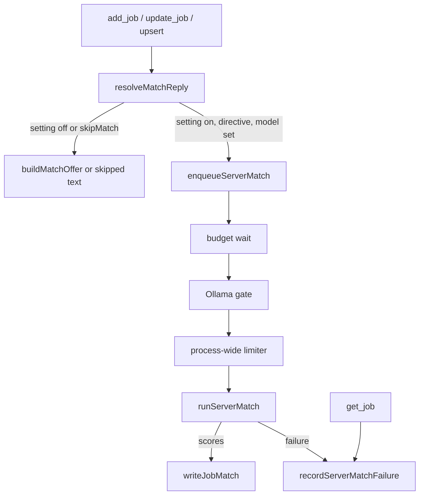

# Design Document — server-side-match

## Overview

JobSync scores MCP-added jobs itself: an MCP add or description update, with the new setting on, puts the job on an in-process match queue, and a background run calls the user's provider with the in-app Match prompt, preprocessing and parser, then saves the result. The reply decision wraps the existing `buildMatchOffer` (`src/lib/mcp/tools/matchDirective.ts:65-141`). Every match call (in-app, automation, on-demand analysis, server-side) gains one shared provider-options constant that turns DeepSeek thinking off.

## Steering Document Alignment

### Technical Standards (tech.md)
The steering files tech.md and structure.md do not exist; the design follows the patterns the touched code already uses: in-memory per-user windows (`src/lib/mcp/rate-limit.ts:23-49`), `generateText` inside `withSpan` (`src/actions/automation/analyze.ts:92-127`), and `p-limit` for concurrency (`src/lib/scraper/automation-run/aiSettings.ts:18-24`).

### Project Structure (structure.md)
New server-match files go in `src/lib/mcp/serverMatch/` because only MCP handlers enqueue; the shared match write goes in `src/lib/jobs/` beside `createJobFromNames`.

### Design System (design-system.md) — if applicable
N/A — no design-system.md. The one new control reuses `Switch` (`src/components/ui/switch.tsx:8-29`) and `Label`.

## Architecture

The MCP handlers call `resolveMatchReply` instead of `buildMatchOffer`: it returns the base offer when the setting is off, else enqueues a match and returns a "queued" reply. The queue holds one entry per job and runs `runServerMatch` (load, preprocess, generate, parse, save) under a per-user budget, Ollama gate and process-wide limiter. A failed run writes a reason and time that `get_job` shows until a newer match exists.



## Components and Interfaces

### C1 — Match provider options
- **Purpose:** One constant that every match call passes so DeepSeek runs with thinking disabled (Req 1, Req 2.4).
- **Interfaces:** new file `src/lib/ai/matchProviderOptions.ts` exports `MATCH_PROVIDER_OPTIONS` with the value `{ deepseek: { thinking: { type: "disabled" } } }`.
- **Post-conditions:** the key is `deepseek` only, so the other providers' options keys are absent (Req 1.5). The option is sent whatever the model name, so a stored `deepseek-reasoner` also runs with thinking off (Req 2.4).
- **Call sites:**
  - `src/lib/agent/nestedGeneration.ts`: `NestedGenerationArgs` gains an optional trailing field `extraProviderOptions` (the `providerOptions` type `streamText` accepts). The call at lines 98-107 passes `{ ollama: { options: { num_ctx: numCtx } }, ...extraProviderOptions }`. With the field absent, the object is the same as today, so `review_resume` and `generate_cover_letter` are unchanged (Req 1.7, invariant).
  - `src/lib/agent/tools/matchJob.ts:88-109`: passes `extraProviderOptions: MATCH_PROVIDER_OPTIONS` (Req 1.1).
  - `src/lib/scraper/automation-run/match.ts:78-84` and `src/actions/automation/analyze.ts:112-117`: each `generateText` call adds `providerOptions: MATCH_PROVIDER_OPTIONS` (Req 1.2, 1.3).
  - C6 passes it (Req 1.4).
  - `src/app/api/ai/chat/route.ts` is not edited (Req 1.6, invariant).
- **Reuses:** probe of the installed `@ai-sdk/deepseek` 2.0.4: the option schema (`node_modules/@ai-sdk/deepseek/dist/index.js:300-307`), the `deepseek` options key (`node_modules/@ai-sdk/deepseek/dist/index.js:418-420`, `node_modules/@ai-sdk/deepseek/dist/index.js:805`), the copy into the body (`node_modules/@ai-sdk/deepseek/dist/index.js:473`). `generateText` takes `providerOptions` in the installed `ai` 6.0.256 (`node_modules/ai/dist/index.d.ts:1361-1390`).

### C2 — DeepSeek model enum and default
- **Purpose:** Name `deepseek-flash` as the default and the only fallback (Req 2.1, 2.2).
- **Interfaces:** `DeepseekModel` (`src/models/ai.model.ts:37-40`) becomes one member, `DEEPSEEK_FLASH = "deepseek-flash"`; `DEEPSEEK_CHAT` and `DEEPSEEK_REASONER` are removed. `getDefaultModelForProvider` (`src/lib/scraper/automation-run/aiSettings.ts:26-39`) returns `DeepseekModel.DEEPSEEK_FLASH`.
- **Post-conditions:** `getFallbackModels` (`src/components/settings/AiSettings.tsx:76-87`) needs no edit; `Object.values(DeepseekModel)` yields `["deepseek-flash"]`. No code reads or rewrites a stored model name, so a stored retired alias is sent unchanged (Req 2.3, invariant).

### C3 — Server-side match setting
- **Purpose:** The opt-in flag, read without a session (Req 3).
- **Interfaces:**
  - `AiSettings` (`src/models/userSettings.model.ts:3-6`) gains `serverSideMatch?: boolean`. Absent reads as off (Req 3.1). `defaultUserSettings` (`src/models/userSettings.model.ts:22-30`) is not changed.
  - `updateUserSettings` (`src/actions/userSettings.actions.ts:48-112`) changes its parameter type from `Partial<UserSettingsData>` to `{ ai?: Partial<AiSettings>; display?: Partial<DisplaySettings> }`. The merge body is unchanged; it already spreads `currentSettings.ai` under `settings.ai` (lines 68-72).
  - New server action `updateServerSideMatch(enabled: boolean)` in the same file calls `updateUserSettings({ ai: { serverSideMatch: enabled } })`. The merge keeps the stored provider and model (Req 3.2).
  - `updateAiSettings` is unchanged; its `{ provider, model }` patch merges over the stored `ai`, so a stored `serverSideMatch` survives a model save (Req 3.3).
  - MCP reads go through `getUserAiSettings(userId)` (`src/lib/scraper/automation-run/aiSettings.ts:41-55`), which reads by user id with no session (Req 3.4).
- **UI:** new client component `src/components/settings/ServerMatchSettings.tsx`, rendered after `AiSettings` in the "ai-provider" section (`src/app/dashboard/settings/page.tsx:25`). It loads the value with `getUserSettings`, then shows a `Switch` with id `server-side-match` and the label "Score MCP jobs on the server". The helper text is "Jobs added or updated over MCP are scored in the background with the model above, using your provider key." Toggling calls `updateServerSideMatch(checked)`. On success it shows `toastSuccess("Server-side matching on.")` or `"…off."`; on failure it reverts the switch and calls `toastError` with the returned message. It is a separate component so the `AiSettings` suite's module mock (`__tests__/AiSettings.spec.tsx:6-9`) stays valid.

### C4 — Reply decision (`resolveMatchReply`)
- **Purpose:** Choose directive, note, queued or skipped for one add or description update (Req 3.5, 4.1-4.9, 8).
- **Interfaces:** new file `src/lib/mcp/serverMatch/offer.ts`:
  - `resolveMatchReply(jobId: string, userId: string, completeness: DescriptionCompleteness | null, context: "add" | "update", skipMatch?: boolean): Promise<MatchReply>`
  - `type MatchReply = { kind: "directive" | "note" | "queued" | "skipped"; text: string }`
  - `readServerMatchSettings(userId): Promise<{ enabled: boolean; provider: AiProvider; model: string | undefined }>` wraps `getUserAiSettings`. A throw or a non-`true` flag reads as off.
- **Order (post-conditions):**
  1. `skipMatch === true` → `{ kind: "skipped", text: SKIPPED_TEXT }`. The settings are not read and no offer is built (Req 8.2, 8.3).
  2. Read the settings. If off → return `buildMatchOffer(jobId, userId, completeness, context)` unchanged (Req 3.5, invariant).
  3. `offer = buildMatchOffer(...)`. If `offer.kind === "note"` → return it (Req 4.6).
  4. If the settings have no model → `{ kind: "note", text: NO_MODEL_TEXT }` (Req 4.7).
  5. `enqueueServerMatch({ jobId, userId, provider, model })` → `{ kind: "queued", text: QUEUED_TEXT }` (Req 4.1-4.3, 4.11).
- **Texts (exact):**
  - `QUEUED_TEXT`: "Server-side match queued — JobSync will score this job with the configured AI model; read the result later with get_job."
  - `SKIPPED_TEXT`: "Match skipped on request (skipMatch) — no fit analysis will be run for this job."
  - `NO_MODEL_TEXT`: "No match queued — no AI model is configured. Pick one in Settings → AI Provider to enable server-side matching."
  - None contains `SYSTEM PROMPT:` or `save_match_result` (Req 4.5).
- **`composeOfferMessage`** (`src/lib/mcp/tools/matchDirective.ts:144-151`) widens its `offer.kind` type to the `MatchReply` union. The body is unchanged: a directive gets a blank line and every other kind gets one space.

### C5 — MCP handler wiring
- **Purpose:** Route the three write paths and the skip flag through C4 (Req 4, Req 8).
- **Changes:**
  - `McpAddJobInputShape` (`src/models/mcp.schema.ts:29-73`) gains `skipMatch: z.boolean().optional().describe("Set true to ask JobSync not to score this job: no match directive, no server-side match.")`. `McpAddJobSchema` and the batch item (`src/models/mcp.schema.ts:325-336`) inherit it (Req 8.1).
  - `handleAddJob` (`src/lib/mcp/tools/addJob.ts:8-46`) calls `resolveMatchReply(result.jobId, userId, result.descriptionCompleteness ?? "title-only", "add", input.skipMatch)` in place of `buildMatchOffer`. `createJobFromNames` destructures its input (`src/lib/jobs/createJobFromNames.ts:54-75`), so the extra field is ignored there.
  - `upsertExisting` (`src/lib/mcp/tools/addJob.ts:57-78`) strips `skipMatch` with `upsert` and `allowDuplicate` at line 62. On a changed description it calls `resolveMatchReply(..., "update", input.skipMatch)` (Req 4.3, 8.5).
  - `handleUpdateJob` (`src/lib/mcp/tools/updateJob.ts:7-37`) calls `resolveMatchReply(..., "update")` with no skip flag; `update_job` gets no `skipMatch` (requirements D4).
  - These replies stay as at base: the duplicate path (`src/lib/mcp/tools/addJob.ts:27-36`), the not-updated and description-unchanged paths, the rate-limit replies, and `handleGetJob` with `matchDirective` (Req 4.8, 4.9, invariants; `skipMatch` does not alter them — D13). `handleAddJobsBatch` needs no edit; each item goes through `handleAddJob` and its labelled line carries that item's reply (Req 4.4).
  - `MCP_TOOL_DESCRIPTIONS` (`src/lib/mcp/toolDescriptions.ts:5-32`): `add_job` and `add_jobs_batch` each append "The reply carries a match directive, or states that the match is queued when server-side matching is on. Pass skipMatch: true to skip scoring a job." `update_job` changes "requests a fresh match analysis" to "requests a fresh match analysis: the reply carries a match directive, or states that the match is queued when server-side matching is on" (Req 4.12).

### C6 — Server match run (`runServerMatch`)
- **Purpose:** One match with the in-app method, scoped to the token's user (Req 5, 7).
- **Interfaces:** new file `src/lib/mcp/serverMatch/run.ts`: `runServerMatch(task: ServerMatchTask, timeoutMs?: number): Promise<"saved" | "failed" | "dropped">`, where `ServerMatchTask = { jobId: string; userId: string; provider: AiProvider; model: string }`. `timeoutMs` defaults to `APP_CONSTANTS.AI_JOB_MATCH_TIMEOUT_MS`.
- **Steps (post-conditions):**
  1. `resolveJobForAgent(userId, jobId)` (`src/lib/agent/jobLookup.ts:12-27`); `no_job` → `"dropped"` with no write (Req 7.6). The description is read here, at run time (Req 5.2).
  2. `resolveResumeForAgent(userId, { pageResumeId: job.resumeId ?? undefined })`, as `src/lib/mcp/tools/matchDirective.ts:95-100`; `no_resumes` or `needs_selection` → fail.
  3. `Promise.all([preprocessResume(resume), preprocessJob(job)])`; job failure first, then resume failure → fail (Req 5.1, 7.2).
  4. `getModel(provider, model, userId)` (`src/lib/ai/providers.ts:7-23`); a throw → fail.
  5. Inside `withSpan("mcp.server_match", …)` with `genAiRequestAttrs` (surface `SURFACES.JOB_MATCH`), call `generateText`. It gets `system: JOB_MATCH_SYSTEM_PROMPT`, `prompt: buildJobMatchPrompt(resumeNormalized, jobNormalized)`, `temperature: TEMPERATURES.FEEDBACK`, `abortSignal: AbortSignal.timeout(timeoutMs)`, and `providerOptions: { ollama: { options: { num_ctx: APP_CONSTANTS.AI_OLLAMA_NUM_CTX } }, ...MATCH_PROVIDER_OPTIONS }` (Req 5.3, 1.4). A throw → fail; `finishReason !== "stop"` → fail (Req 7.2).
  6. `parseJobMatch(text)` (`src/lib/ai/jobMatch/parse.ts:24-45`); no scores → fail (Req 5.4, 7.2).
  7. Build `matchData` (Data Models) and call `writeJobMatch(userId, jobId, scores.matchScore, JSON.stringify(matchData))` (C7) → `"saved"` (Req 5.5, 5.6). A Prisma `P2025` from the write means the job is gone → `"dropped"` (Req 7.6).
- **Fail:** call `recordServerMatchFailure(userId, jobId, reason)`. It runs `prisma.job.updateMany({ where: { id: jobId, userId }, data: { serverMatchError: reason, serverMatchFailedAt: new Date() } })`. A count of 0 → `"dropped"`, with no record and no error line. Otherwise it logs one `log.error("[server-match] match failed", { jobId, userId, provider, model, reason })` → `"failed"` (Req 7.3). The fail path never writes `matchScore` or `matchData`, so an existing match stays (Req 7.2, requirements D10).
- **Reasons (exact, closed set):** "No resume could be resolved — set a default resume in Profile → Resumes." · "The job description could not be prepared for matching." · "The resume could not be prepared for matching." · "Provider error: " plus the error message cut to 200 characters · "Timed out after N s." (N = `timeoutMs / 1000`, used when the timeout signal aborted) · "The generation stopped early (finish reason: X)." · "The reply had no SCORES line."
- **Telemetry:** reuse `SURFACES.JOB_MATCH` (`src/lib/telemetry/genai.ts:7-14`; the on-demand analysis already uses it for the shared prompt, `src/actions/automation/analyze.ts:100-109`). The span adds `jobsync.user_id` and `jobsync.job_id`.

### C7 — Shared match write (`writeJobMatch`)
- **Purpose:** One user-id-scoped write for `saveJobMatchResult` and the server match (Req 5.5).
- **Interfaces:** new file `src/lib/jobs/writeJobMatch.ts` (not a "use server" module): `writeJobMatch(userId: string, jobId: string, matchScore: number, matchData: string): Promise<void>`. It runs `prisma.job.update({ where: { id: jobId, userId }, data: { matchScore, matchData } })` and lets a `P2025` throw.
- **Post-conditions:** `saveJobMatchResult` (`src/actions/job/status.ts:52-70`) replaces its inline update with `writeJobMatch(user.id, jobId, matchScore, matchData)`. Its session check, return shape and error mapping through `handleError` (`src/lib/utils.ts:43-60`) do not change.

### C8 — Queue, budget and limiter
- **Purpose:** Background execution with per-job coalescing and limits of its own (Req 4.10, 4.11, 6, NFR reliability).
- **Interfaces:**
  - `src/lib/mcp/serverMatch/budget.ts`: `takeServerMatchBudget(userId: string): { allowed: boolean; resetIn: number }`. This is a per-user window with its own `Map`, the same shape as `checkMcpRateLimit` (`src/lib/mcp/rate-limit.ts:23-49`). The max is `mcpRateLimitMax()` and the window is `APP_CONSTANTS.MCP_RATE_LIMIT_WINDOW_MS` (Req 6.3). It never calls `checkRateLimit` (Req 6.2, 6.5).
  - `src/lib/mcp/rate-limit.ts`: `configuredMax` (lines 13-17) is exported as `mcpRateLimitMax()`. `MAX` keeps its value, and the budget calls the function at check time.
  - `src/lib/mcp/serverMatch/queue.ts`:
    - `enqueueServerMatch(task: ServerMatchTask): void` is synchronous and returns before any await (Req 4.11).
    - `whenServerMatchIdle(): Promise<void>` and `resetServerMatchQueue(): void` exist for tests.
- **State:** one object on `globalThis` (key `__jobsyncServerMatch`), as the Prisma client is held (`src/lib/db.ts:12-18`). It holds:
  - `entries: Map<string, { task; state: "queued" | "running"; rerun: boolean }>` keyed `` `${userId}:${jobId}` ``;
  - `limiter = pLimit(APP_CONSTANTS.SERVER_MATCH_CONCURRENCY)`;
  - `ollamaGate = pLimit(1)`.
- **Enqueue post-conditions:**
  - No entry → add a `queued` entry and start `drive(key)` without awaiting it.
  - Entry `queued` → replace its `task` with the newer one (latest provider and model). The queued run reads the description at run time, so no second run is needed.
  - Entry `running` → set `rerun = true` and replace the task.
  - At most one run per job at a time and at most one pending (Req 4.10, requirements D14).
- **`drive(key)`:**
  1. Loop: `takeServerMatchBudget(userId)`. If not allowed, sleep `resetIn` ms and try again. Over-budget matches wait and never fail for that reason (Req 6.4, requirements D11), and the wait holds no limiter slot.
  2. If the provider is `AiProvider.OLLAMA`, run through `ollamaGate`, then `limiter`; otherwise only through `limiter`. Total in flight is at most the constant and Ollama in flight is at most 1 (Req 6.1). This bound covers server matches only; `ollamaGate` does not coordinate with the automation runner's or in-app Match's Ollama use, so cross-surface Ollama concurrency is unchanged and pre-dates this spec.
  3. Set `state = "running"` and `await runServerMatch(task)` inside try/catch. A throw is logged and treated as a failure (NFR: one failure does not stop the others).
  4. On finish: if `rerun`, set `rerun = false` and `state = "queued"` and loop from step 1; otherwise delete the entry.
- **Process:** the state is in memory; a restart drops it with no failure record (NFR reliability, requirements D2).

### C9 — get_job failure line
- **Purpose:** Show a server-match failure that no later match superseded (Req 7.4, 7.5, 5.8).
- **Change:** `renderDetail` (`src/lib/mcp/tools/getJob.ts:50-111`) appends one line after the score block ("Not scored." or the score with body). The line is `Server-side match failed YYYY-MM-DD: <reason>`, using the existing `day()` helper. It appears when `job.serverMatchFailedAt` is set AND one of these is true: the score is hidden, `matchedAt` is missing, or `matchedAt` is earlier than `serverMatchFailedAt`.
- **Post-conditions:** any later saved match, on any surface, sets a later `matchedAt` and hides the line (Req 7.5). Rows with null failure columns render as at base (Req 3.5). A saved server match renders through the existing score line as `via deepseek/deepseek-flash` (Req 5.8, invariant). `GET_JOB_INCLUDE` uses `include`, so the new scalars load with no edit.

## Data Models

### Job (Prisma) — two new nullable columns
```
// prisma/schema.prisma, model Job, after descriptionCompleteness (line 476)
serverMatchError    String?    // last server-side match failure reason
serverMatchFailedAt DateTime?  // when it failed
```
Migration `prisma/migrations/20261030120000_job_server_match_failure/migration.sql`, in the style of the existing ADD COLUMN migrations:
```
ALTER TABLE "Job" ADD COLUMN "serverMatchError" TEXT;
ALTER TABLE "Job" ADD COLUMN "serverMatchFailedAt" DATETIME;
```
The backup Job row schema (`src/lib/backup/schema.ts:191-216`) is not extended, and `BackupDataSchema.parse` (`src/lib/backup/export.ts:109`) strips the columns from a backup. A restore therefore drops failure records (D9).

### matchData written by a server match
```
{ matchScore, recommendation, body,            // from parseJobMatch
  resumeId, resumeTitle,                       // resolved resume
  matchedAt: new Date().toISOString(),
  provider: task.provider,                     // e.g. "deepseek"
  model: task.model,                           // name sent, e.g. "deepseek-flash"
  surface: APP_CONSTANTS.SERVER_MATCH_SURFACE, // "server"
  analyzed: true,
  descriptionCompleteness: job.descriptionCompleteness ?? undefined }
```
This fits `JobMatchData` (`src/models/ai.schemas.ts:60-76`) with no type change. `"server"` differs from `"chat"` (`src/lib/constants.ts:169`) and `"mcp"` (`src/lib/constants.ts:159`) (Req 5.6). A `"partial"` completeness shows the existing provisional badge (`src/components/automations/MatchDetails.tsx:42-50`; Req 5.7, invariant).

### Constants (`src/lib/constants.ts`)
- `SERVER_MATCH_SURFACE: "server"`, next to `AGENT_CHAT_MATCH_SURFACE`.
- `SERVER_MATCH_CONCURRENCY: 3`, next to `AUTOMATION_MATCH_CONCURRENCY` (line 109).

### AiSettings
`serverSideMatch?: boolean` is stored inside the existing `ai` JSON in `UserSettings.settings`, so no migration is needed.

## Error Handling

1. **Settings read throws (corrupt JSON):** read as off; the add does not fail.
2. **Run failure (provider, timeout, finish reason, no scores, unreadable input):** C6 records the reason; the "queued" reply already returned and the existing match stays (Req 7.1, 7.2).
3. **Job deleted:** C6 ends `"dropped"`, no record or error line (Req 7.6).
4. **Unexpected throw in `drive`:** caught and logged; others continue.
5. **Process restart:** the queue is lost; re-score with `get_job` + `matchDirective: true` or in-app Match.

## Testing Strategy

No test calls a real provider. Each generation test stubs `getModel` (`vi.mock("@/lib/ai/providers")`) to return `MockLanguageModelV3` from `ai/test` (`node_modules/ai/dist/test/index.d.ts:53-70`), and asserts `doGenerateCalls[i].providerOptions` (`node_modules/@ai-sdk/provider/dist/index.d.ts:1467`).

- **Unit:**
  - `__tests__/matchProviderOptions.spec.ts` (new):
    - The automation match and the analysis each send `providerOptions.deepseek.thinking.type === "disabled"` and no other key beyond `ollama` where present (Req 1.2, 1.3, 1.5).
    - A stored `deepseek-reasoner` is sent as the model id unchanged with thinking disabled (Req 2.3, 2.4).
  - `__tests__/agentNestedGeneration.spec.ts`: `extraProviderOptions` merges after the `ollama` key, and the call without it sends exactly `{ ollama: … }` (Req 1.7 regression guard).
  - `__tests__/agentMatchJobTool.spec.ts`: `match_job` passes `MATCH_PROVIDER_OPTIONS` (Req 1.1).
  - `__tests__/automationAiSettings.spec.ts` (new): `getDefaultModelForProvider(DEEPSEEK) === "deepseek-flash"` (Req 2.1).
  - `__tests__/AiSettings.spec.tsx`: the DeepSeek fallback list is `["deepseek-flash"]` when the models fetch fails (Req 2.2). The existing `deepseek-chat` cases mock a live list and stay green.
  - `__tests__/userSettingsServerMatch.spec.ts` (new):
    - `updateServerSideMatch` keeps provider and model, and `updateAiSettings` keeps `serverSideMatch` (Req 3.2, 3.3).
    - No stored value reads as off (Req 3.1).
  - `__tests__/ServerMatchSettings.spec.tsx` (new): renders off by default, toggling calls the action, and a failure reverts the switch.
  - `__tests__/serverMatchOffer.spec.ts` (new): runs the C4 order over each branch:
    - skip;
    - off returns the `buildMatchOffer` result by deep equality (Req 3.5 invariant);
    - a note passes through;
    - no model;
    - queued, with `enqueueServerMatch` called once.
    - The three texts lack `SYSTEM PROMPT:` and `save_match_result`.
  - `__tests__/serverMatchQueue.spec.ts` (new): uses fake timers and a stubbed `runServerMatch`, and asserts:
    - in flight never exceeds `SERVER_MATCH_CONCURRENCY`, and is 1 for Ollama tasks;
    - three enqueues of one job while it runs give exactly two runs;
    - an enqueue while queued gives one run;
    - an over-budget enqueue waits past `resetIn`, then runs;
    - 50 runs leave `checkRateLimit(userId).remaining` unchanged (Req 6.5);
    - a throwing run does not stop the next one.
  - `__tests__/serverMatchRun.spec.ts` (new): mocks Prisma and lookups like `__tests__/mcpAddJob.spec.ts:10-34`, and asserts:
    - saved `matchData` fields (Req 5.6), the prompt, temperature and options sent (Req 5.3), and the description read at run time (Req 5.2);
    - each failure reason writes the failure columns and never `matchScore` (Req 7.2, 7.3);
    - the `no_job` and `P2025` paths drop with no record (Req 7.6);
    - `runServerMatch(task, 5)` with a never-resolving mock records the timeout reason.
  - `__tests__/mcpGetJob.spec.ts`: the failure line shows when there is no match or an older match, is hidden after a newer `matchedAt`, and rows without the columns render byte-identically (Req 7.4, 7.5, 3.5).
- **Integration:**
  - `__tests__/mcpAddJob.spec.ts`, `__tests__/mcpUpdateJob.spec.ts` and `__tests__/mcpBatch.spec.ts` gain a mock of `readServerMatchSettings`. With it off, every existing exact-text assertion stays as is (regression guard).
  - With it on, the suites assert:
    - queued text and no directive (Req 4.1-4.3, 4.5);
    - the note cases (Req 4.6);
    - no model (Req 4.7);
    - the duplicate and unchanged paths (Req 4.8);
    - `skipMatch` on add, on upsert and on batch items, and a duplicate-without-upsert add with `skipMatch` that keeps its base reply (Req 8.2-8.5, D13);
    - per-item lines in a batch (Req 4.4).
  - One end-to-end handler test runs `handleAddJob` → real queue → `runServerMatch` with the mock model. It awaits `whenServerMatchIdle()` and asserts that the write happened after the reply resolved (Req 4.11).
- **End-to-end:** `e2e/mcp-server-match.spec.ts` (new) uses no provider call:
  - It turns the switch on in Settings → AI Provider and checks that it stays on after a reload (Req 3.2).
  - Over MCP, `add_job` with `skipMatch: true` and the `FULL_POSTING` fixture (`e2e/mcp-write-tools.spec.ts:15-32`) replies with the skipped text and no `SYSTEM PROMPT:` (Req 8.3).
  - A title-only `add_job` replies with the thin-description note (Req 4.6).
  - The queued path is not run end to end (D10); integration tests cover it.

## Decisions taken in this document

- D1 — Setting storage: an optional flag inside the stored ai settings; chosen because the MCP path already reads ai settings by user id with no session, and the existing merge keeps the flag across a model save.
- D2 — Setting control: a separate switch component under the AI provider form that saves on toggle; chosen because the provider form's Save is disabled with no model selected, and a separate component keeps the form's tests untouched.
- D3 — Reply decision placement: a new wrapper that calls the existing offer builder unchanged; chosen because the setting-off reply then is the base function's output by construction.
- D4 — Limiter shape: one process-wide limiter at the concurrency constant plus a one-slot gate for Ollama tasks in front of it; chosen because users can have different providers, and this holds both bounds at once.
- D5 — Budget size: equal to the configured MCP hourly budget, including its environment override; chosen because every queued match follows one MCP unit, so this keeps the requirement's floor even when the operator raises the MCP budget.
- D6 — Over-budget wait happens before the limiter slot is taken; chosen because a waiting user must not block other users' matches for up to an hour.
- D7 — Failure record: two nullable job columns, shown when no match is newer, by timestamp; chosen because the timestamp rule covers every surface without touching their writes, and match data stays untouched on failure.
- D8 — Shared write: extract the session-free user-scoped update and have the session action call it; chosen because the background run has no session and the requirement asks for the same write.
- D9 — Backups do not carry the failure columns; chosen because a failure record is transient and is redone by a re-score.
- D10 — No end-to-end run of the queued path; chosen because the key resolver's environment fallback could reach a real provider, which the testing requirement forbids, and the handler-to-save path is covered with a mock model.
- D11 — Telemetry surface: reuse the job-match surface value; chosen because the surfaces set is closed at six and the on-demand analysis already uses this value for the same prompt.
- D12 — Saved surface value is "server"; chosen because it is short and differs from "chat" and the "mcp" marker.
- D13 — Skipped text is emitted only on the add/update paths that reach `resolveMatchReply` (C4 step 1); the paths that return before it — a duplicate without upsert (`addJob.ts:27-36`), an unchanged description (`addJob.ts:65-67`), the rate-limit reply (`addJob.ts:14-18`) and the `catch` error reply — keep their base reply. Chosen because `skipMatch:true` never reaches `enqueueServerMatch` on those paths, so Req 8.2's no-queue guarantee holds everywhere and no match was on offer to skip; this scopes Req 8.3's skipped text to the offer paths, with Req 4.8 governing the early returns.
- D14 — Model and provider are taken at enqueue time, and a newer enqueue replaces them on a pending entry; chosen because the Ollama gate needs the provider before the run starts.
- D15 — Retired DeepSeek enum members are removed rather than kept as hidden aliases; chosen because no code references them and the fallback list derives from the enum.

## Scope notes

- Carried from requirements: none.
- Settled here from the requirements' deferred list:
  - setting key and label (C3);
  - reply texts (C4);
  - surface value (D12);
  - concurrency and budget values (C8, D5);
  - failure storage (D7);
  - telemetry surface (D11).
- Not cut: every requirement is covered.
- Out of scope as in the requirements.

## Revision History

- **v2** (2026-10-31) — Round-1 adversarial response (adversarial-analysis-design.md, verdict iterate 0/1/2).
  - **R1-1 — Partially accepted (SHOULD_FIX).** Rewrote D13 to scope the skipped text to the paths that reach the reply decision; the early returns — duplicate without upsert, unchanged description, rate-limit and error — keep their base reply, since skip never reaches the enqueue there and no match was on offer. This scopes Req 8.3 to the offer paths while Req 8.2's no-queue holds everywhere; added a duplicate-with-skip integration case and noted the same scoping on the C5 bullet.
  - **R1-2 — Accepted (MINOR).** Dropped the matchData illustrative hedge and committed the shape.
  - **R1-3 — Accepted (MINOR).** Added a note that the Ollama-one bound covers server matches only, not the automation runner's or in-app Match's Ollama use.
  - **Lint pass.** 0 fixed; L-1–29 all rejected as citation-lint artifacts (@-scoped node_modules paths that resolve on the real tree, identifiers this design newly introduces, or symbols cited elsewhere and only name-referenced here).
- **v1** (2026-10-30) — Initial draft.
  - **Lint pass.** 13 fixed. Rejected: L-3,5,6,7,8,38,39 @-scoped node_modules paths resolve on the real tree (linter artifact); L-10,13,15,18,21,31,34,36 new identifiers this design adds; L-12,14,20,22,23,24,25,30,32,33,37,40 builtins or symbols cited elsewhere.
